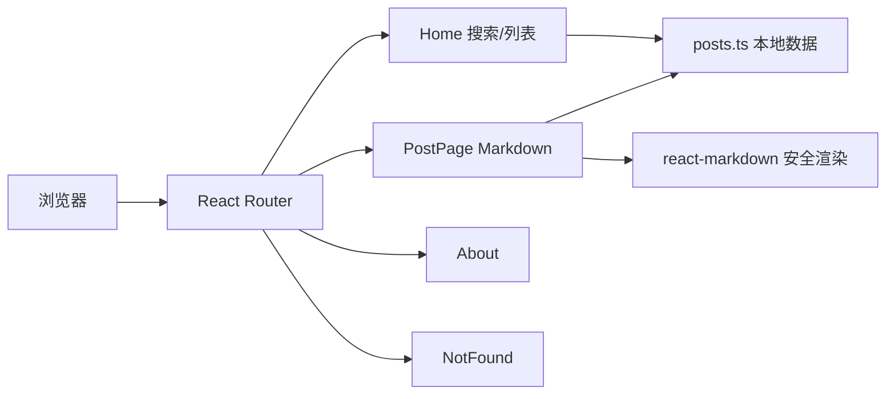

# 项目 01：学习笔记博客（React/TS）

> 独立代码位置：`E:\fullstack-code\Web\project01-blog`（不在 `02-项目实战` 内塞代码）。
> 本地可运行；已用 Cloudflare Quick Tunnel 做临时公网 HTTPS 验证（无自定义域名）。技术栈：React 19 + TypeScript 7 + Vite 8 + React Router 7 + react-markdown 10。

## 1. 用户价值与范围

给个人学习笔记提供一个可搜索、可深链、键盘可用的静态博客。

- 主路径：首页浏览 → 搜索 → 打开详情 → 返回。
- 非目标：登录/评论/后台编辑/数据库/SSR；这些留给后续项目。
- 内容：5 篇本地 Markdown；没有外部 CMS。

## 2. 运行与验证

```bash
cd E:\fullstack-code\Web\project01-blog
npm ci
npm run typecheck
npm run test
npm run build
npm run e2e
```

或一键：

```bash
bash scripts/run_project.sh
cat evidence/run.txt
```

## 3. 架构



- 路由：`/`、`/posts/:slug`、`/about`、`*`。
- 搜索状态：URL `?q=`，可分享、可前进后退。
- Markdown：`react-markdown`，不启用原始 HTML、不使用 `dangerouslySetInnerHTML`。
- 可访问性：跳转链接、`main` 焦点、可见焦点环、`aria-current`、`role=status`。

## 4. 测试与证据

| 项 | 实际 | 证据 |
| --- | --- | --- |
| 类型检查 | 0 error | `evidence/typecheck.txt` |
| 组件测试 | 7/7 通过 | `evidence/test.txt` |
| 生产构建 | `vite build` 成功；JS 382.13 kB / gzip 120.33 kB | `evidence/build.txt` |
| E2E（headless Edge） | 首页 5 卡、跳转链接聚焦 main、搜索 1 条、进入详情 | `evidence/e2e.txt`、`e2e-post.png` |
| 公网 HTTPS（临时） | Quick Tunnel 返回 200，TLS 校验通过 | `evidence/public-https.txt` |
| manifest | SHA-256 校验 | `evidence/manifest.json` |

## 5. 范围与边界

- 没有后端/数据库/认证；内容在构建时打包。
- 公网 HTTPS 只用 Cloudflare Quick Tunnel 做过临时验证；无自定义域名、持久部署、CDN 或缓存头。
- E2E 只跑 Edge headless，没有 Firefox/Safari；没有真实手机/读屏。
- 搜索是同步字符串匹配，没有分词/拼音/高亮；数据量大时需要索引或后端搜索。
- 没有分页/标签页/ RSS；3 篇内容不足以证明内容规模。
- 没有监控/错误上报；没有性能预算。

## 6. 交付证据

- `docs/adr/0001-markdown-safety.md`：Markdown 安全取舍。
- `docs/adr/0002-search-url-state.md`：搜索状态放 URL。
- `docs/bugs/001-search-state.md`：一次真实 Bug 复盘。
- `docs/review.md`：自审范围、问题、残留风险。
- `evidence/`：命令输出、截图、manifest。

## 7. 已知限制

构建产物约 382 kB（gzip 120 kB），主要来自 React/路由/Markdown；没有做代码分割/懒加载。若作为真实产品，应按路由拆分并测 LCP/INP。本仓库只证明功能与测试闭环，不宣称性能最优。
