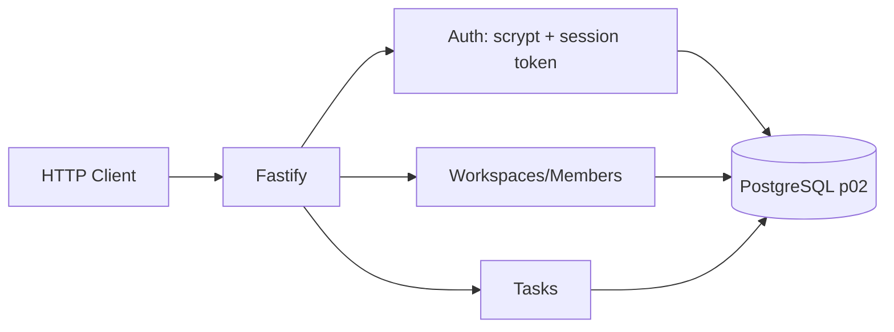
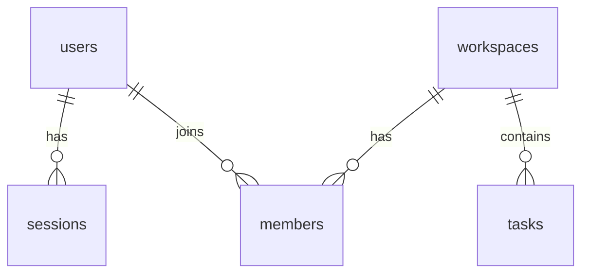

# 项目 02：协作任务平台（Fastify + PostgreSQL）

> 独立代码位置：`E:\fullstack-code\project02-collab`。本地 API，未部署公网。
> 技术栈：Node 24 + Fastify 5.12.8 + PostgreSQL 18.6 + pg 8.23.1。

## 1. 用户价值与范围

多租户协作任务平台的最小闭环：注册/登录 → 创建工作区 → 邀请成员 → 创建任务 → 改状态。

- 租户边界：workspace；所有读写都通过 membership 限定。
- 角色：owner / member；成员增删与角色变更仅 owner。
- 不变量：任何工作区至少保留 1 个 owner（父行锁串行化）。
- 非目标：前端 UI、实时协作、通知、审计日志、公开注册限制、生产部署。

## 2. 运行与验证

```bash
cd E:\fullstack-code\project02-collab
npm ci
export PGPASSWORD=<local-test-password>
bash scripts/run_project.sh
cat evidence/run.txt
```

本地启动（需已迁移）：

```bash
node scripts/migrate.mjs
npm start
```

## 3. 架构与数据模型





表：`users`、`sessions`、`workspaces`、`members(workspace_id,user_id,role)`、`tasks(workspace_id,title UNIQUE)`。

## 4. API

- `POST /auth/register`、`POST /auth/login`、`POST /auth/logout`、`GET /me`
- `POST /workspaces`、`GET /workspaces`、`GET /workspaces/:id`
- `POST /workspaces/:id/members`、`DELETE/PATCH /workspaces/:id/members/:userId`
- `GET/POST /workspaces/:id/tasks`、`PATCH /tasks/:taskId`

OpenAPI 摘要见 `openapi.json`；错误统一 `{error:...}`，不返回堆栈。

## 5. 实测结果

| 项 | 实际 | 证据 |
| --- | --- | --- |
| 迁移 | 5 张表 | `evidence/migrate.txt` |
| 真实 DB 测试 | 7/7 通过 | `evidence/test.txt` |
| 最后 Owner | 删除/降级 409；并发删除 `[204,409]`，最终 owner=1 | `evidence/test.txt` |
| 租户隔离 | 跨租户 workspace/task 404 | `evidence/test.txt` |
| 唯一约束 | 重复 slug/任务标题 409 | `evidence/test.txt` |
| 备份恢复 | dump→DROP→restore 成功 | `evidence/backup.txt` |
| 门禁 | `gate_failures: 0` | `evidence/run.txt` |

## 6. 边界

1. 单机 PostgreSQL；没有连接池调优/多实例/复制。
2. 没有前端/实时/通知/审计；任务只有标题与状态。
3. 认证只有密码 + 不透明 token；无 MFA/限流/密码重置/邮件验证。
4. 没有 OpenAPI 运行时校验；`openapi.json` 是人工维护摘要。
5. 备份恢复同机同版本；无 RPO/RTO/PITR；dump 不入 Git。
6. 没有部署、HTTPS、监控告警；未测真实移动端/浏览器。
7. 没有外部评审；测试是合成数据。

## 7. 文档

- `docs/adr/0001-session-token.md`
- `docs/adr/0002-tenant-owner-lock.md`
- `docs/bugs/001-last-owner-race.md`
- `docs/review.md`
